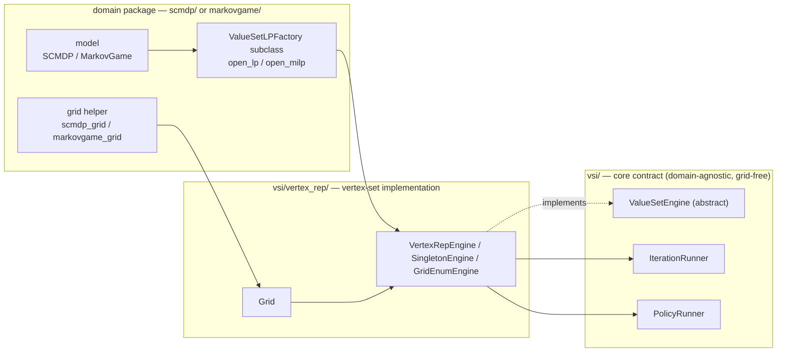
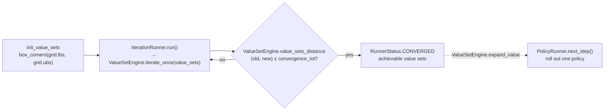
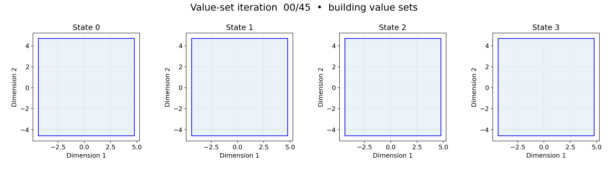
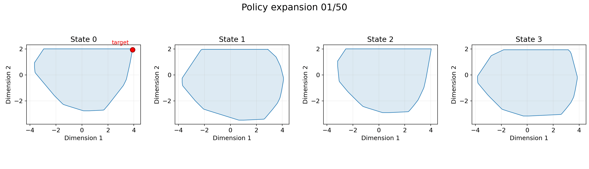
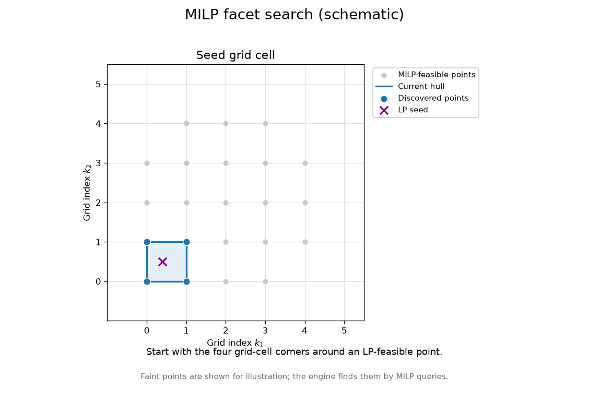

# VSI Design

Value-set iteration (VSI) computes, for each state, the *set* of achievable value
vectors rather than a single scalar value. The `vsi/` package is domain-agnostic:
it runs iteration and stores value sets. Each domain (`scmdp/`, `markovgame/`)
supplies only the per-state optimization model and value-space grid.

The design centers on one abstraction, `ValueSetEngine`, plus two runners that
drive it. `vsi/vertex_rep/` provides the main implementation (`VertexRepEngine`).
Other engines can be swapped in through the same interface.

To see an engine run end-to-end on a small, hand-built instance, read the worked
examples under [`examples/`](../../examples/) alongside this guide — e.g.
[examples/scmdp/two_state.py](../../examples/scmdp/two_state.py).

## Architecture at a glance

A domain supplies three pieces (left); the grid-free `vsi/` core defines the
contract and runners, while `vsi/vertex_rep/` supplies the grid and the concrete
engines that implement it (right):



## The contract — `ValueSetEngine` and its runners

One abstract engine defines the VSI operations; two runners consume an engine and
drive those operations.

```
ValueSetEngine  (abstract — the VSI contract)
│     iterate_once(value_sets)     one forward Bellman step over all states
│     expand_value(v, s, value_sets)  decompose one value → actions + onward values
│     value_sets_distance(a, b)    convergence metric
│
├── IterationRunner(engine)        drives iterate_once until convergence
│         run(), run_iter()          loop to completion / yield each iterate
│         result, status             final sets + why it stopped
│
└── PolicyRunner(engine, value_sets, policy)   drives expand_value to roll out a policy
          next_step()                  expand the current policy by one step
```

The same contract, drawn as a loop — each node names the engine method or runner
that drives it:



Both runners are thin loops over the engine methods and do not touch domain logic.
`IterationRunner` finds the fixed point, starting from caller-supplied
value sets (built from the grid, e.g. the bounding-box corners):

```python
value_sets = uniform_value_sets(box_corners(grid.lbs, grid.ubs), num_states)  # seed from the box
while True:
    next_value_sets = engine.iterate_once(value_sets)  # one Bellman step
    if engine.value_sets_distance(value_sets, next_value_sets) <= tol:
        value_sets = next_value_sets
        break                                         # status = CONVERGED
    value_sets = next_value_sets
```

This SCMDP single-run demo shows the sets changing at each iteration. The
outlined boundary marks the current iterate; the animation starts from the
initial box and ends at the converged sets. The panels use the same axis scale.



`PolicyRunner` walks the other way. It wraps `expand_value` so you can run a
policy forward, sampling an action at each step and advancing on the observed
outcome:

```python
runner = PolicyRunner(engine, value_sets, policy)
while True:
    runner.next_step()                    # expand current policy via expand_value
    a = runner.sample_action()            # sample from the resulting action_probs
    outcome = env.step(a)                 # observe (action, next state)
    runner.receive_step_outcome(outcome)  # advance to the matching onward policy
```

Each `next_step()` must be followed by `receive_step_outcome()` before the next
expansion. An invalid outcome leaves the expansion pending so the caller can
provide the correct outcome; `restart()` clears the rollout state.

The same object can also answer "what does this policy play after a given history?"
Replay past outcomes, then read the next action distribution:

```python
runner = PolicyRunner(engine, value_sets, policy)
for outcome in history:                   # feed the observed (action, state) steps
    runner.next_step()
    runner.receive_step_outcome(outcome)
probs = runner.next_step().action_probs   # distribution the policy assigns next
```

So `iterate_once` and `expand_value` are inverse-facing operations: one builds
achievable sets, the other expands one achievable value into action and onward
values.

In the corresponding policy rollout, the red dot is the current **target
value**. The next frame shows onward values from its decomposition in the
possible successor states. The rollout then samples an action and successor
state and repeats; the animation shows the saved example, not every possible
policy branch.



## Vertex representation — the default engine

`vertex_rep/` is one implementation of the contract, based on the
**vertex representation** of value sets and a **grid-based** discretization of
the value space.

```
vertex_rep/
├── engine.py            VertexRepEngine — the default engine (integer hull via MILP)
├── _execution.py        map_states — state scheduling and solver worker environments
├── _gurobi_env.py       Quiet shared environment for serial optimization queries
├── _progress.py         Progress sinks and optional terminal display
├── value_set_lp.py      ValueSetLPFactory — domain hook, solver settings, and sessions
├── grid.py              Grid            — value-space grid (spacing + optional bounds)
├── initial_sets.py      box_corners / box_centre / uniform_value_sets — seed helpers
├── singleton_engine.py  SingletonEngine — lightweight: one point per state
└── baselines/           GridEnumEngine  — brute-force grid enumeration (reference)
```

Apart from the engines, the folder contains the following key components:

- `ValueSetLPFactory` is the domain hook. A subclass implements `_build_model`
  to build the LP defining achievable values at a state. The factory
  holds the problem and solver settings, reports `num_states` and `reward_dim`,
  and opens `LPSession` or `MILPSession` objects for the engine. The MILP session
  adds integer grid constraints to the LP; no separate MILP factory is needed.
  `scmdp/` and `markovgame/` each supply a subclass (see below).
- `Grid` supplies a positive spacing and optional integer index bounds; it
  does not require a finite bounding box. It normalises supplied bounds to
  `int64` and rejects bounds outside that range. An unbounded grid requires
  caller-supplied initial value sets rather than a box-corner seed.

An engine is built by wiring these together, with `lp_factory` a domain-specific
`ValueSetLPFactory` instance bound to the problem:

```python
engine = VertexRepEngine(lp_factory, grid)
```

Conceptually, `VertexRepEngine.iterate_once` follows this sequence. This
Python-style pseudocode omits seeding and solver bookkeeping; `...` stands for
implementation details. `open_milp` builds the domain LP, attaches grid indices,
and returns a session that closes the model after use:

```python
def iterate_once(self, value_sets):
    new_value_sets = [None] * self.num_states
    for s0 in range(self.num_states):  # states may run in parallel
        with self.lp_factory.open_milp(s0, value_sets, grid=self.grid) as milp:
            new_value_sets[s0] = ...  # hull vertices found by solving the MILP
    return new_value_sets
```

### Two practical levers

Two ideas keep this operator tractable in practice.

The first is the **MILP integer-hull formulation**: rather than enumerate every
candidate value vector, the engine builds one MILP model per state and solves it
repeatedly in separating directions to discover the grid-hull vertices. (The
brute-force alternative — enumerating every grid point and testing membership —
is what `GridEnumEngine` does, and why it serves only as a reference baseline.)

The schematic below follows one per-state search. Starting from a grid cell
around a feasible LP point, it queries the MILP in outward facet directions,
adds newly found extreme grid points, and repeats until no facet finds another
point. The faint grid points are illustrative: this is **not** a recorded
solver run or an exhaustive enumeration performed by `VertexRepEngine`.



The second is **parallelism across states**. Notice that the loop body for state
`s0` reads only the *previous* iterate `value_sets` and writes an independent
entry `new_value_sets[s0]`; distinct states never interact within a single
step. The operator is therefore embarrassingly parallel across states, so
`iterate_once` can dispatch the per-state solves to a thread pool instead of
running them one at a time. This is a second practical approach to making VSI
tractable, orthogonal to the MILP formulation, and it is turned off by default:

```python
engine.set_param(vsi_operator_parallel=True)   # solve the states concurrently
engine.set_param(max_workers=8)                # optional thread-pool size
engine.set_param(show_progress=False)          # optional: hide progress bars
```

`iterate_once` delegates state execution to `map_states` in `_execution.py`.
The mathematical steps remain together in `_compute_value_set`, while
`_progress.py` handles progress display. Progress bars are enabled by default;
disabling them leaves ordinary logging unchanged.

`map_states` reports completion using each returned point count. Engines send
intermediate updates through a progress sink; with reporting disabled, `NullSink`
discards these updates without creating a display.

Each iteration has a compact separator, followed by point-count and distance
summaries. Live state rows disappear after the iteration; their counters show
work in the current phase (for example, facets in one hull-search round), not
progress toward convergence. The final log reports the stopping reason and
iteration count.

When `vsi_operator_parallel` is `False` (the default) the states are solved
sequentially. When it is enabled, `max_workers` bounds the pool size, defaulting
to `min(num_states, os.cpu_count())` — i.e. one worker per state, capped at the
available cores. In the experiment harness the same switch is exposed as the
`parallel_by_state` flag on `AlgorithmConfig` (see [experiments.md](experiments.md)).

Each worker owns a separate Gurobi environment, created before the worker
threads start and released after they stop. Models within a worker reuse that
environment sequentially. Each environment sets Gurobi's internal `Threads`
parameter to one, so `max_workers` controls the parallelism without nesting a
second solver thread pool inside every state-level worker. `_execution.py`
passes each worker a factory adapter bound to its environment; the engine uses
only `open_lp` and `open_milp`. Sequential calls use the ordinary factory and
the shared quiet environment described below.

### Solver settings

The factory holds immutable `LPSolverParams` and `MILPSolverParams`. Configure
them when constructing the factory; engine parameters control facet separation,
parallel execution, and progress reporting:

```python
from vsi import LPSolverParams, MILPSolverParams

lp_factory = SCMDPLPFactory(
    problem,
    lp_params=LPSolverParams(opt_tol=1e-9, fsb_tol=1e-9, trim_distr_tol=1e-6),
    milp_params=MILPSolverParams(int_feas_tol=1e-9, mip_gap=0, mip_gap_abs=0),
)
engine = VertexRepEngine(lp_factory, grid)
engine.set_param(facet_sep_tol=1e-6, show_progress=False)
```

These are the defaults. Keep MILP gaps at zero to avoid missing hull vertices.
`open_lp` creates an LP session; `open_milp` additionally attaches integer
grid indices. Policy expansion uses an LP session, without the MILP machinery.

Geometry helpers such as `polytope_distance` use their own solver defaults.
Direct callers can adjust `solver_tol`, which controls the internal LP's
feasibility and optimality tolerances, not a guaranteed distance-error bound.
`IterationRunner` independently owns the convergence threshold.

### Inputs and model lifetime

Non-empty value sets passed to the engine must have finite values and shape
`(n, reward_dim)`; empty sets may have an unspecified dimension. The geometry
helpers handle one-dimensional hulls as intervals, while higher-dimensional
facets use SciPy's `ConvexHull`. The facet search in dimensions two and above
requires the initial grid-cell corners to span the value space. Fixed grid
coordinates or clipping a seed cell at a boundary can violate this requirement;
the engine raises an informative error if hull construction fails rather than
returning an incomplete result. The supplied domain grid helpers pad their
bounds, so their usual grids avoid this case.

The facet tolerance and solver parameters must be finite and nonnegative. A
session disposes its model when it closes; worker environments close after the
workers stop.

Serial sessions and geometry distance LPs share one private, quiet Gurobi
environment, created on first use and kept for the process lifetime. Configure
solver settings through the factory's parameter objects, not Gurobi's default
environment. The built-in state parallelism is supported (each worker has its own
environment), but concurrent engine runs or geometry queries from application
threads are not.

`SingletonEngine` and `GridEnumEngine` are alternative engines in the same folder.
Since they honor the same contract, the runners accept any of them without change.

- `SingletonEngine` keeps a single point per state. This is useful when you only
  need **one** point from each achievable value set: it is fast, since each state
  uses an LP or QP solve rather than a MILP. (Value-set iteration need not converge
  with this engine — in particular, it may fail to converge to a nonempty singleton
  set.) It takes no grid argument. Internally it subclasses `VertexRepEngine`
  with a dummy grid and disables grid-based expansion slack.
- `GridEnumEngine` takes a different route to the vertex representation: it
  enumerates the whole grid and tests whether each grid point lies in the value
  set. It is far less efficient than the MILP-based `VertexRepEngine` and is meant
  only as a benchmark.

## Domain instantiations: `scmdp/` and `markovgame/`

A domain typically provides three pieces. The grid-based engine constructors
consume the factory and `Grid`; the factory holds the model, and a grid helper
constructs the `Grid`:

| piece | `scmdp/` | `markovgame/` | role |
| --- | --- | --- | --- |
| model | `SCMDP` | `MarkovGame` | problem data (rewards, transitions, gamma, …) |
| `ValueSetLPFactory` subclass | `SCMDPLPFactory` | `MarkovGameLPFactory` | `_build_model(...)` — the domain hook |
| grid | `scmdp_grid` | `markovgame_grid` | turns a target accuracy into a `Grid` |

The `ValueSetLPFactory` subclass carries the real domain logic: its `_build_model`
method defines how the domain-specific value-set LP is constructed. The model is
just data, and the grid helper only converts a target accuracy into a
bounding box and grid spacing.

Wiring these three together is all it takes to build an engine:

```python
from scmdp import SCMDP, SCMDPLPFactory, scmdp_grid
from vsi import (
    VertexRepEngine, IterationRunner, box_corners, uniform_value_sets,
)

problem = SCMDP.from_functions(...)
grid = scmdp_grid(problem, eps=0.2, delta=0.2)

engine = VertexRepEngine(
    SCMDPLPFactory(problem),   # the domain hook — bound to the problem
    grid,
)
runner = IterationRunner(engine)
runner.run(
    init_value_sets=uniform_value_sets(box_corners(grid.lbs, grid.ubs), problem.num_states),
    max_iters=200,
)
```

**One domain factory works with every engine in `vertex_rep/`.** The factory is
unchanged when you swap engines, but `SingletonEngine` does not take a grid:

```python
from vsi import SingletonEngine
from vsi.vertex_rep.baselines import GridEnumEngine

engine = SingletonEngine(SCMDPLPFactory(problem))
engine = GridEnumEngine(SCMDPLPFactory(problem), grid)
```

So defining a domain — model, `ValueSetLPFactory` subclass, and grid helper —
lets you use the full vertex-rep family with no further domain changes:
`VertexRepEngine`, `SingletonEngine`, and `GridEnumEngine`.

## Related guides

- [Adding a domain](adding-a-domain.md) — a step-by-step walkthrough of the three
  pieces a new domain supplies.
- [Experiments and demos](experiments.md) — the harness that drives the engine and
  renders figures.
